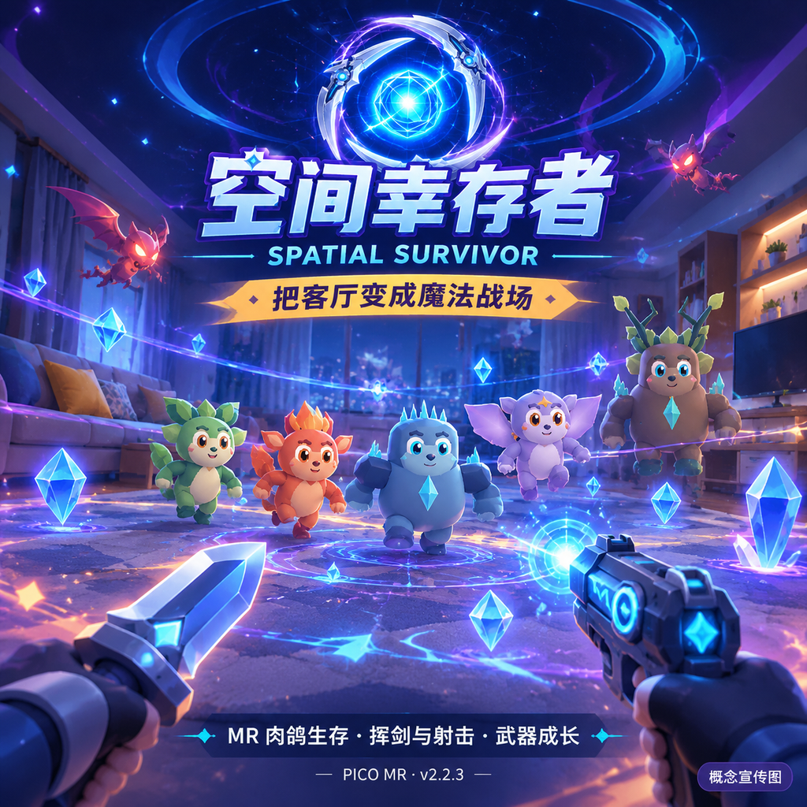

# 空间幸存者 · SpatialSurvivor Unity

把客厅变成魔法战场，用挥剑与射击对抗怪潮，在混合现实中打造你的生存流派。



面向 PICO 头显的 Unity/C# 混合现实肉鸽生存游戏。扫描真实房间后，玩家通过真实走位、近战挥击、枪械和自动技能迎战地面与飞行怪物，获得强化、技能进化与局外武器成长。海报为概念宣传图，编辑器与实机验证记录见下文。

- 当前版本：**2.2.3 / versionCode 15**
- Unity：**6.6 · 6000.6.8f1**
- PICO Unity SDK：**6.1.1**
- Android 包名：`com.example.spatialsurvivor.unity`
- 平台：Android ARM64 / IL2CPP / OpenGLES3

## 游戏内容

- 真实房间扫描、MR 透视、空间网格、定位恢复和设置诊断。
- 近战连续挥击、星火手枪、符文霰弹枪，以及八把可装备手持武器。
- 9 类自动武器、39 张强化卡、6 种进化、随机选卡与永久成长。
- 地面和飞行魔法生物、波次、Boss、骨骼动画与魔法技能特效。
- 技能手册、怪物图鉴、武器商店、独立局外金币和本地进度存档。
- 世界空间菜单与战斗 HUD，支持手柄射线和手势交互。

## 下载后打开

仓库包含项目自有源码和资源。PICO SDK 不在本仓库重新分发，开发机的 SimHei 字体也不公开；请先恢复依赖再打开 Unity。

1. 安装 **Unity 6000.6.8f1** 及 Android Build Support（SDK、NDK、OpenJDK）。
2. 从 [PICO 官方开发者网站](https://developer.picoxr.com/) 获取 **PICO Unity SDK 6.1.1**，按其条款下载并解压 `com.bytedance.pico.xr` 包。确认目录内 `package.json` 的 name 和 version 正确。
3. 在项目根目录运行以下命令，把路径替换为实际解压目录：

```powershell
.\Tools\Prepare-PublicClone.ps1 -PicoSdkPath "D:\SDK\com.bytedance.pico.xr"
```

脚本复制 SDK 到忽略的本地嵌入目录，应用两个编辑器导入兼容守卫，并将仓库内 OFL Noto Sans SC 恢复到既有中文字体资源路径。若已有可用 SDK 或字体，保留现有文件。详见 [第三方说明](THIRD_PARTY_NOTICES.md)。

4. Unity Hub 添加本目录，用 Unity 6000.6.8f1 打开，等待 Package Manager 导入完成。
5. 打开 `Assets/Scenes/SpatialSurvivor.unity`。菜单 `SpatialSurvivor → Initialize Project` 可重新生成配置与美术资源。

## 操作与构建

编辑器模拟：WASD 移动、鼠标右键转向、鼠标确认；Enter 开始、1–4 选卡、Escape 暂停。

PICO：真实走位，手柄射线＋扳机点击 UI；战斗时挥动近战武器，使用枪械扳机射击。手势支持取决于设备追踪状态。首次进入主菜单的「MR 设置」并完成授权和房间扫描，没有有效房间网格时不会刷怪。

在 Unity 菜单选择 `SpatialSurvivor → Build Android APK`，或运行：

```powershell
.\Tools\Build-Android.ps1 -UnityEditor "D:\Unity\6000.6.8f1\Editor\Unity.exe"
```

输出 `Builds/SpatialSurvivorUnity.apk`，默认是开发构建和调试签名。脚本中的编辑器路径可通过参数覆盖，构建输出不提交到 Git。

## 目录与验证

- `Assets/Scripts`：规则、成长、战斗、MR、平台输入与 UI。
- `Assets/Editor`：项目初始化、模型和动画生成、Android 图标与构建处理。
- `Assets/Tests/Editor`：玩法、MR 状态、UI、导航、挥击/射击与渲染回归。
- `Assets/Scenes`、`Assets/Resources`：场景、模型、材质、字体引用、插画与图标。
- `Packages`、`ProjectSettings`：依赖清单、嵌入 GLTF 包和 Unity 配置。
- `Tools`：依赖恢复、打开 Unity、测试、Android 打包和旧进度导入辅助。
- `Marketing`：作品资料、应用图标、概念海报与生成提示词。

Unity 6 下 **2.2.1 的完整回归为 95/95 通过**。2.2.3 完成构建、真机安装和包回读，用户确认射线完整、点击正常、全新安装后的应用图标正常。2.2.3 的图标/构建工具修正未重跑全部玩法测试，完整长时战斗、舒适度和性能仍需验收；公开字体恢复方案也尚未做头显验收。详细记录：[验证范围](Docs/VALIDATION.md)、[版本说明](RELEASE_NOTES.md)、[开发历史](Docs/DEVELOPMENT_HISTORY.md)。

运行已有测试：

```powershell
.\Tools\Run-GameTests.ps1 -UnityEditor "D:\Unity\6000.6.8f1\Editor\Unity.exe"
```

公开仓库不包含 Unity 生成缓存、设备日志、APK、签名密钥或受限 SDK。发布为公开仓库不改变第三方资源的原有权利；详情见 [第三方说明](THIRD_PARTY_NOTICES.md)。
